## 👨‍💻 About me

- 🎓 Studying **Software Development** at TTK University of Applied Sciences in Tallinn
- 🚀 Building my own tools for trainers and teams: [**Discality**](https://discality.org) and [**Team Action Plan**](https://teamactionplan.com)
- 🌱 Currently learning **Laravel** and **web application security**
- 🪖 Completed Estonian conscript service as a **Junior Sergeant**, so teamwork and pressure don't scare me
- ⚡ Fast learner, keeps code tidy, asks early when something is unclear
- 📫 Reach me on [LinkedIn](https://www.linkedin.com/in/georg-volov-9b0b73271) or at **georgvolov@gmail.com**

## 🛠️ Tech stack

  

| Area | Tools |
|---|---|
| **Languages** | JavaScript, TypeScript, C#, PHP, HTML, CSS |
| **Backend** | Node.js, Express, Laravel *(learning)* |
| **Databases** | MySQL, Firebase Firestore |
| **Frontend tooling** | Vite, Parcel, Tailwind CSS, daisyUI |
| **Deployment** | Linux (Ubuntu), nginx, pm2, DigitalOcean |

## 🚀 What I'm building

### [Discality](https://discality.org)

A DiSC-style personality test made for trainers and consultants. Participants take the test on their phones, and the trainer walks the group through the results.

- Live group sessions with join codes and a credit system for businesses
- 15 original personality profiles, three result graphs and downloadable PDF reports
- Accounts with email verification, JWT auth and Stripe payments
- **Stack:** HTML · CSS · JavaScript · Node.js · Express · Firestore · nginx

### [Team Action Plan](https://teamactionplan.com)

Part of my growing set of tools for trainers, consultants and teams.

## 📊 GitHub stats

  
  

## 🐍 Contributions

  

